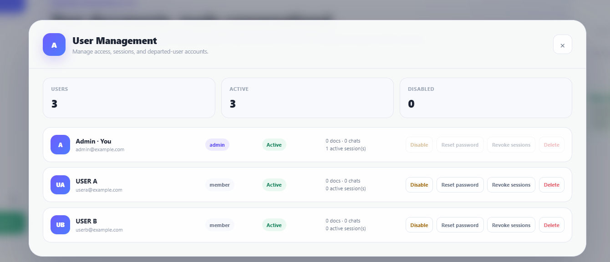
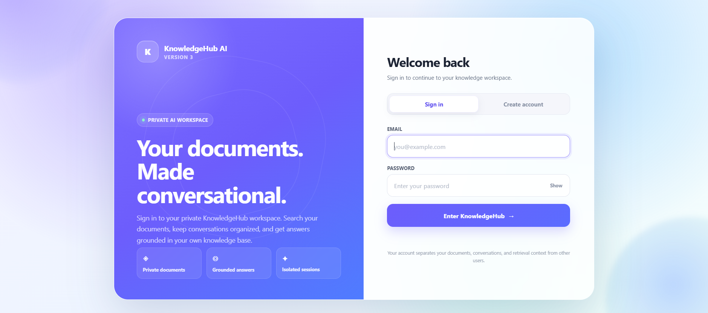
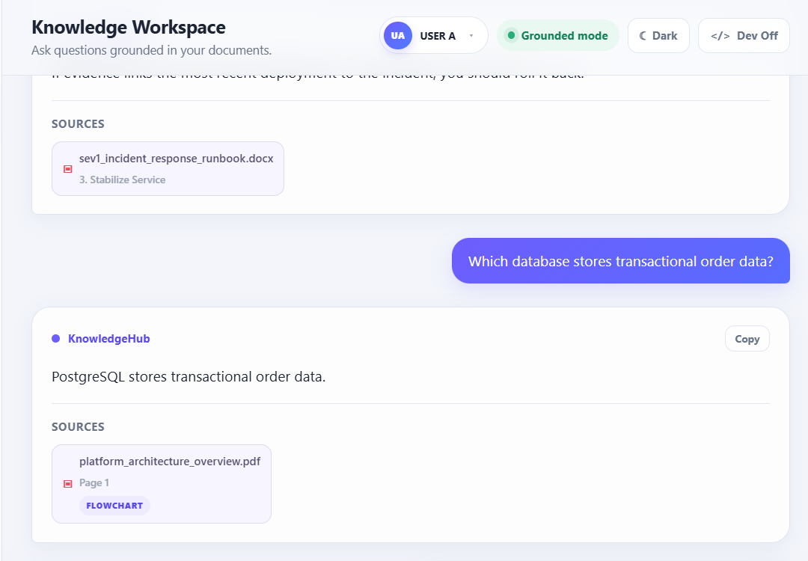
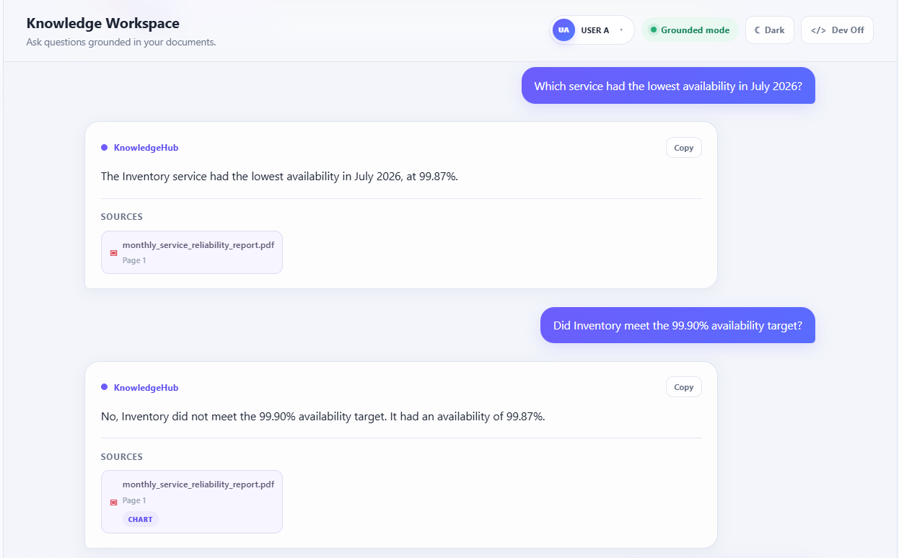
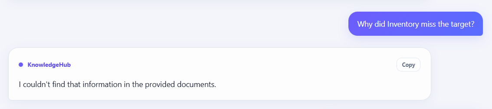
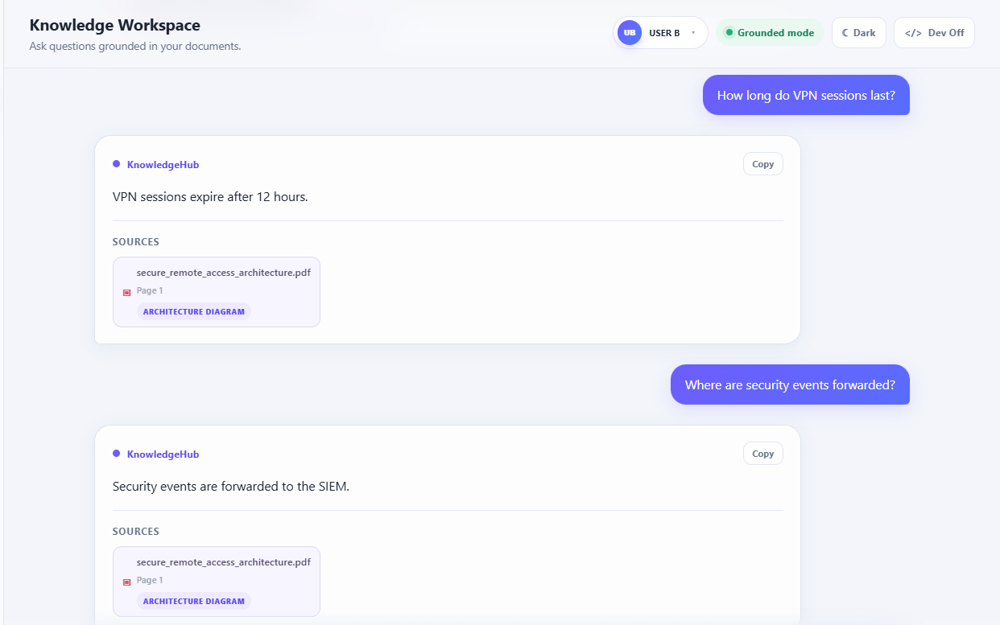
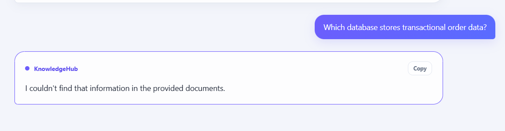
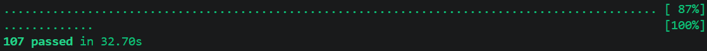

# KnowledgeHub AI

[**Live Application**](https://knowledgehub-ai-cum.pages.dev)  

**KnowledgeHub AI** is a multi-user, multimodal Retrieval-Augmented Generation (RAG) application that allows users to build private knowledge bases from their documents and ask questions grounded in the information those documents contain.

The project was built iteratively across three versions, evolving from a basic document-question-answering pipeline into a more complete knowledge workspace with authentication, user isolation, multimodal document understanding, hybrid retrieval, conversational follow-ups, source transparency, and automated testing.

---

## KnowledgeHub AI V3

V3 focuses on making the application behave more like a real multi-user AI knowledge system rather than a single-user RAG prototype.

Major additions include:

- User authentication and account management
- Private per-user knowledge bases
- Cross-user document and retrieval isolation
- Admin user-management capabilities
- Multi-format document ingestion
- Multimodal document understanding
- Chart, flowchart, and architecture-diagram interpretation
- Hybrid semantic + lexical retrieval
- Wider candidate retrieval followed by reranking
- Conversational follow-up questions
- Grounded answer generation
- Unsupported-question rejection
- Source metadata and evidence display
- Expanded automated test coverage

---

## Screenshots

### Admin User Management

Administrators can manage application users, account state, sessions, and user access.



---

### Authentication

KnowledgeHub AI V3 introduces authenticated workspaces so documents, conversations, and retrieval context can remain isolated between users.



---

### Multimodal Flowchart Retrieval

KnowledgeHub can retrieve information represented visually inside documents instead of relying exclusively on extracted paragraph text.



---

### Chart Reasoning and Grounded Analysis

Visual document content can participate in retrieval and answer generation.

In this example, KnowledgeHub interprets service availability information contained in a chart and answers both a direct question and a conversational follow-up.



---

### Grounded Rejection

KnowledgeHub is designed not to invent an answer when the retrieved documents do not provide sufficient evidence.



---

### Separate User Knowledge Base

A second authenticated user can maintain a completely different document collection and retrieve information from their own technical documents.



---

### Cross-User Data Isolation

A user cannot retrieve information that exists only inside another user's knowledge base.



---

### Automated Testing

The final V3 build passes the complete automated test suite:

**107 tests passed**



---

# How It Works

At a high level, KnowledgeHub follows this pipeline:

```text
Document Upload
      ↓
Document Type Detection
      ↓
Format-Specific Parsing
      ↓
Text + Visual Content Extraction
      ↓
Chunking
      ↓
Embedding Generation
      ↓
PostgreSQL + pgvector
      ↓
Semantic Candidate Retrieval
      ↓
Hybrid Reranking
      ↓
Candidate Relevance Gate
      ↓
Grounded LLM Answer Generation
      ↓
Answer + Supporting Sources
```

---

# Hybrid Retrieval

V3 moves beyond relying only on vector similarity.

The retrieval system first obtains a wider semantic candidate pool and then reranks those candidates using a hybrid relevance score.

The current hybrid score combines:

```text
70% Semantic Similarity
30% Lexical Relevance
```

Conceptually:

```python
hybrid_score = (
    0.70 * vector_similarity
    + 0.30 * lexical_relevance
)
```

The candidate retrieval stage searches a pool of at least **50 chunks** before reranking and returning the strongest candidates.

This helps recover document passages that may contain important exact terminology while still benefiting from semantic similarity.

---

# Multimodal Document Understanding

Traditional RAG systems frequently depend only on extracted text.

That creates problems when important information exists inside:

- Charts
- Architecture diagrams
- Flowcharts
- Screenshots
- Scanned pages
- Images containing text
- Other document visuals

KnowledgeHub V3 introduces a visual-analysis pipeline that uses Gemini multimodal capabilities to convert useful visual information into structured textual evidence.

Recognized visual categories include:

```text
architecture_diagram
flowchart
chart
screenshot
scanned_page
image_with_text
diagram
other_visual
```

The resulting visual evidence can then participate in embedding, retrieval, reranking, and grounded answer generation alongside ordinary document text.

---

# Multi-Format Document Processing

V3 introduces a parser architecture instead of coupling document processing to a single format.

Current parser modules include:

```text
backend/parsers/
├── base.py
├── pdf_parser.py
├── docx_parser.py
├── markdown_parser.py
├── txt_parser.py
└── __init__.py
```

This makes document ingestion easier to extend as additional formats are introduced.

---

# Authentication and User Isolation

KnowledgeHub V3 supports multiple authenticated users.

User records include account information such as:

- Role
- Active/disabled state
- Password-change state
- Authentication/session information

The first registered account can become the application administrator.

More importantly, document retrieval is scoped by user identity.

Conceptually:

```text
USER A
 ├── Documents A1, A2, A3
 ├── Conversations
 └── Retrieval Context

USER B
 ├── Documents B1, B2
 ├── Conversations
 └── Retrieval Context
```

User A's retrieval operations should not expose User B's private document chunks, and vice versa.

This isolation is validated through both automated tests and manual smoke testing.

---

# Grounded Answer Generation

KnowledgeHub follows a document-grounded answering strategy.

Retrieved candidates must pass the relevance stage before being supplied as supporting context for answer generation.

When sufficient supporting information is unavailable, KnowledgeHub can reject the question rather than generating an unsupported answer.

Example:

```text
User:
Why did Inventory miss the target?

KnowledgeHub:
I couldn't find that information in the provided documents.
```

This distinction is important.

The documents may prove that Inventory missed its availability target without explaining **why** it happened.

KnowledgeHub therefore avoids inventing a cause.

---

# Conversational Follow-Ups

KnowledgeHub maintains limited recent conversation context so users can ask natural follow-up questions.

Example:

```text
User:
Which service had the highest availability?

KnowledgeHub:
The Checkout service had the highest availability at 99.98%.

User:
What about Payments?

KnowledgeHub:
The Payments service had an availability of 99.95% in July 2026.
```

Conversation history is used to resolve what the user is referring to, while document evidence remains the basis for the final answer.

---

# Sources and Transparency

Answers can include supporting source information such as:

- Filename
- Page number
- Section
- Chunk index
- Source metadata
- Retrieval relevance

This makes the RAG process easier to inspect and helps users understand where an answer originated.

---

# Technology Stack

### Backend

- Python
- FastAPI
- PostgreSQL
- pgvector
- Gemini API

### Document Processing

- PyMuPDF
- PDF parsing
- DOCX parsing
- Markdown parsing
- TXT parsing
- Gemini multimodal visual analysis

### Retrieval

- Vector embeddings
- PostgreSQL + pgvector similarity search
- Lexical relevance scoring
- Hybrid reranking
- Candidate relevance gating

### Frontend

- HTML
- CSS
- JavaScript

### Testing

- pytest

### Deployment Infrastructure

- **Cloudflare Pages:** Static frontend hosting and continuous deployment
- **Render:** Hosted FastAPI backend
- **Neon:** Managed PostgreSQL database with pgvector
- **Cloudflare R2:** Uploaded document archive storage
- **Gemini API:** Embeddings, multimodal analysis, and grounded answer generation
- **GitHub:** Source control and deployment integration (`master` branch)

---

# Production Architecture

```text
Browser
   |
   v
Cloudflare Pages — static HTML/CSS/JavaScript frontend
   |
   | HTTPS API requests
   v
Render — FastAPI backend
   |                  |                      |
   v                  v                      v
Neon PostgreSQL   Cloudflare R2          Gemini API
+ pgvector        document archives      embeddings / visual analysis / answers
```

- **Frontend:** [knowledgehub-ai-cum.pages.dev](https://knowledgehub-ai-cum.pages.dev)
- **Backend:** [knowledgehub-ai-backend-696g.onrender.com](https://knowledgehub-ai-backend-696g.onrender.com)
- **Source / production branch:** [`master`](https://github.com/phaneendrakatakam/KnowledgeHub-AI/tree/master)
- **Database:** Neon PostgreSQL with pgvector; the deployed Render service uses the Neon branch `knowledgehub-render-test`.
- **Object storage:** Cloudflare R2 stores uploaded document archives; application metadata, accounts, conversations, and retrieval data reside in PostgreSQL.
- **AI:** Gemini API supports embeddings, multimodal interpretation, and grounded responses.

The previous Google Cloud Run deployment has been retired. The URLs above are the current application endpoints.

---

# Project Structure

```text
KnowledgeHub-AI/
├── backend/
│   ├── parsers/              # PDF, DOCX, Markdown and TXT parsers
│   ├── auth.py               # Authentication and user management
│   ├── db.py                 # PostgreSQL / database configuration
│   ├── ingest.py             # Document ingestion
│   ├── main.py               # FastAPI routes
│   ├── storage.py            # Cloudflare R2 integration
│   ├── rag.py                # RAG pipeline
│   ├── search.py             # Retrieval
│   └── visual_analyzer.py    # Multimodal visual analysis
├── frontend/
│   ├── index.html            # Browser UI
│   └── config.js             # Backend API endpoint configuration
├── screenshots/V3/          # V3 evidence screenshots
├── tests/                   # Automated tests
├── requirements.txt
├── Dockerfile
└── README.md
```

The tree highlights important files rather than every file in the repository.

---

# Local Development

## 1. Clone and install dependencies

```powershell
git clone https://github.com/phaneendrakatakam/KnowledgeHub-AI.git
cd KnowledgeHub-AI
python -m venv .venv
.\.venv\Scripts\Activate.ps1
pip install -r requirements.txt
```

For macOS/Linux, activate the environment using `source .venv/bin/activate`.

## 2. Configure services and secrets

Create the local environment file at the location expected by the backend (see `.env.example` if present). Never commit real credentials.

| Setting | Purpose |
| --- | --- |
| `GEMINI_API_KEY` | Gemini API authentication |
| `DATABASE_URL` | PostgreSQL connection string (Neon or local PostgreSQL with pgvector) |
| `POSTGRES_HOST`, `POSTGRES_PORT`, `POSTGRES_DB`, `POSTGRES_USER`, `POSTGRES_PASSWORD` | Local PostgreSQL connection fields, when using the individual-field configuration |
| R2 account endpoint, bucket, access key and secret | Object-storage credentials used by `backend/storage.py`; match the exact variable names in that module |
| Authentication / session secrets | Configure according to the backend authentication code and deployment settings |

Do not copy example values into production. The database must have the schema and extensions required by the backend; review the repository's database initialization code before first use.

## 3. Start the backend

```powershell
cd backend
uvicorn main:app --reload
```

For local frontend testing, serve `frontend/` through a local static web server. `frontend/config.js` currently points to the deployed Render API; adjust the endpoint for a local backend if needed.

## 4. Run automated tests

From the repository root:

```powershell
pytest
```

The V3 validation snapshot recorded **107 passing tests**. This is a historical V3 test result, not a claim that the latest production commit was retested with the same count.

---

# Deployment Notes

## Cloudflare Pages — frontend

- **Project:** `knowledgehub-ai`
- **Production branch:** `master`
- **Build output directory:** `frontend`
- **Live URL:** https://knowledgehub-ai-cum.pages.dev
- The frontend is static HTML/CSS/JavaScript; its API base URL is configured in `frontend/config.js`.
- Pushing a change to `master` can trigger a new Pages production deployment. Check the deployment status in the Cloudflare dashboard.

## Render — FastAPI backend

- **Service:** `knowledgehub-ai-backend`
- **Production branch:** `master`
- **Live base URL:** https://knowledgehub-ai-backend-696g.onrender.com
- The backend runs as a Render service with dependencies from `requirements.txt` and production configuration supplied through Render environment settings.
- Configure `DATABASE_URL`, Gemini credentials, R2 credentials, and any authentication settings required by the application in the Render dashboard. Do not store secrets in Git.
- When the free instance is idle, the first request may take longer because the service may need to wake up.
- Confirm the actual build/start commands in the Render service settings before reproducing this deployment; do not assume the local development command is the production start command.

## Neon — PostgreSQL + pgvector

- The live Render service connects to Neon using `DATABASE_URL`.
- The currently deployed database branch is `knowledgehub-render-test` (a separate branch from Neon's original `production` branch).
- Preserve the branch used by Render. Deleting or replacing it without updating the Render connection string will break database access.
- Database branches and backups should be managed independently of Git branches.

## Cloudflare R2 — uploaded document archives

- R2 provides durable object storage for document archives, separate from the ephemeral filesystem of the backend host.
- Configure the R2 bucket, endpoint, and credentials through backend environment settings.
- Use least-privilege credentials and keep the bucket private unless a specific public-access use case requires otherwise.
- Validate upload, retrieval, and document deletion behavior after changing storage settings.

## Deployment verification checklist

1. Verify Cloudflare Pages and Render show successful production deployments from `master`.
2. Open the live frontend and sign in.
3. Upload a small supported document and verify it appears in the user's knowledge base.
4. Ask a document-grounded question and check its supporting sources.
5. Refresh and verify the conversation remains available.
6. Check the Render logs and storage/database dashboards if any request fails.

The application passed a final manual end-to-end live test after the hosting migration. This does not replace ongoing security, performance, and load testing.

## Operations and free-tier considerations

- Render free-tier instances may sleep when idle, causing cold-start latency.
- Neon, R2, Cloudflare Pages, Render, and Gemini have independent usage limits and billing policies; check their dashboards for current limits.
- Do not rely on Render's local filesystem for persistent user uploads.
- Keep credentials in service environment settings; rotate them if exposed.
- Maintain database backups or a tested recovery procedure before storing irreplaceable data.
- A Git push can redeploy application code but does not automatically migrate or back up the database.

---

# Version Evolution

## V1 — Core RAG Pipeline

The first version introduced PDF ingestion, text extraction, chunking, Gemini embeddings, PostgreSQL/pgvector similarity search, grounded answer generation, source display, relevance rejection, chat sessions, and automated tests.

## V2 — Reliability and Conversational RAG

V2 introduced a multi-document knowledge base, conversational follow-ups, Sources & Context inspection, retrieval visibility, stronger grounded rejection, and expanded evaluation and tests.

## V3 — Multi-User Multimodal Knowledge Workspace

V3 added authentication, roles, admin user management, user-specific knowledge bases, cross-user retrieval isolation, multi-format parsers, multimodal visual understanding, hybrid retrieval and reranking, richer source metadata, and expanded test coverage (**107 passing tests at the V3 validation milestone**).

## Deployment milestone

The completed V3 application was subsequently migrated from Google Cloud Run to a multi-service deployment using Cloudflare Pages, Render, Neon PostgreSQL, and Cloudflare R2. The original Cloud Run service was retired after the new deployment passed live verification.

---

# Key Engineering Lessons

- **Retrieval quality matters as much as generation:** an LLM cannot use evidence that retrieval never finds.
- **Hybrid retrieval helps:** semantic similarity and exact terminology offer complementary signals.
- **Candidate retrieval differs from final context selection:** retrieve broadly, rerank, then supply focused evidence.
- **Documents are not only text:** charts, diagrams, and scanned visuals can carry essential facts.
- **Grounded rejection is a feature:** when the documents do not support a claim, the system should say so.
- **Multi-user RAG needs retrieval isolation:** authentication alone does not prevent cross-user evidence leakage.
- **Deployment architecture matters:** persistent database and object storage should be decoupled from stateless application hosting.

---

# Current Status and Limitations

**KnowledgeHub AI V3 is implemented and publicly deployed.** The live workflow has been manually verified, including authentication, document upload, question answering, and conversation persistence.

It remains a portfolio-focused engineering project, not an enterprise-scale SaaS offering. Limitations and future work include external OAuth/SSO, background ingestion queues, dedicated learned reranking, more document formats, centralized observability, rate limiting and security hardening, load/concurrency testing, streaming responses, and more advanced multimodal evaluation. Visual understanding remains sensitive to source-document quality; retrieval scoring and thresholds are application-defined.

---

# Author

**Phaneendra Katakam** — Cloud / DevOps engineer exploring AI engineering, retrieval-augmented generation, cloud infrastructure, and practical deployment workflows.
